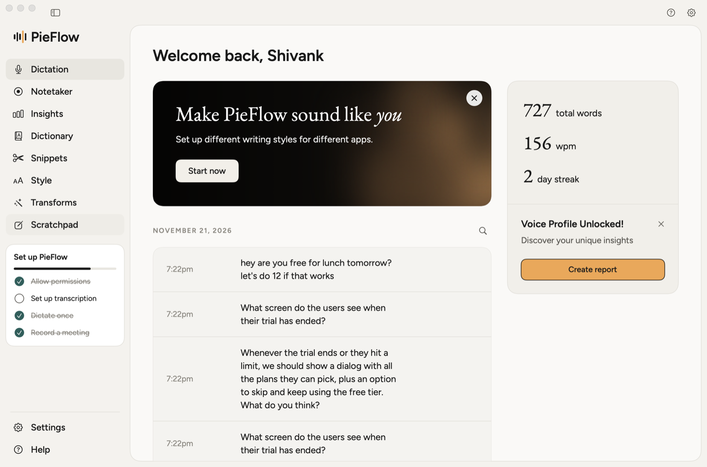

# PieFlow for Mac

Free, open source voice dictation for macOS. Hold `fn`, speak, let go, and clean text lands wherever your cursor is. It also records meetings and writes the notes.

**[Download the latest version](https://github.com/shivankoctupie/pieflow-mac/releases/latest)** (macOS 14 or later, Apple silicon and Intel) · [Website](https://shivankoctupie.github.io/pieflow-mac/)



## What it does

- **Dictation in any app.** Hold `fn` (or Right Option, Right Command, Right Control) to talk. Double tap, or `fn` + space, for hands-free. Esc cancels.
- **Your choice of engine.** Groq Whisper Large v3 Turbo, Grok speech to text (xAI), or local whisper.cpp running fully offline on your Mac. If the cloud is slow or down, the local model takes over after about two seconds.
- **AI cleanup.** Removes filler words, applies self corrections ("Tuesday, no wait, Friday"), and follows a style you set per app (formal, casual, very casual). Without an API key, built in rules do the basics.
- **Dictionary.** Teaches it your names and jargon, and it learns from the edits you make.
- **Snippets.** Say "my email address" and it types the saved text.
- **Transforms.** Select text in any app and press `⌥1` to polish it, or add your own prompts.
- **Notetaker.** Records your mic and the other side of a call, transcribes it live, then writes a summary with action items.
- **Flow Bar.** A small pill that shows when PieFlow is listening. Drag it anywhere on screen.

## Install

1. Download `PieFlow-x.y.z.dmg` from the [latest release](https://github.com/shivankoctupie/pieflow-mac/releases/latest) and drag PieFlow into Applications.
2. Open it. PieFlow is not notarized by Apple, so macOS blocks the first launch. Click Done, then go to System Settings > Privacy & Security, scroll down and click **Open Anyway**. Or run this once in Terminal:

   ```bash
   xattr -dr com.apple.quarantine /Applications/PieFlow.app
   ```

3. Allow Microphone and Accessibility when asked. Accessibility is what lets PieFlow see the `fn` key and paste text.
4. Pick an engine: paste a [Groq](https://console.groq.com) or [xAI](https://console.x.ai) API key, or download a local Whisper model to work offline with no key at all.

If your Mac opens the emoji picker when you press `fn`, set System Settings > Keyboard > "Press fn key to" to "Do Nothing".

PieFlow updates itself: it checks this repository for a new release and installs it when you say so.

## Privacy

- No account, no analytics, no tracking.
- Everything is stored on your Mac in `~/Library/Application Support/PieFlow`, including your API keys.
- Audio and text leave your Mac only for the cloud engines you set up yourself. With a local model and no keys, nothing leaves at all.
- The only other network call is the update check against GitHub.

## Build from source

Needs the Xcode Command Line Tools (full Xcode is not required) and `brew install cmake`.

```bash
scripts/build.sh
```

That builds a universal app at `build/PieFlow.app` and a DMG in `dist/`. `scripts/build-whisper.sh` rebuilds the bundled `whisper-cli`.

## Check a build

```bash
build/PieFlow.app/Contents/MacOS/PieFlow --selftest
```

Prints PASS, SKIP or FAIL for fonts, the data folder, whisper-cli, audio devices, mic capture, the hotkey listener, every engine you configured and AI cleanup.

```bash
PIEFLOW_HOME=/tmp/pf-demo build/PieFlow.app/Contents/MacOS/PieFlow --snapshot /tmp/pf-shots
```

Renders every screen to PNG with demo data in a throwaway data folder. That is how the screenshots in this repository are made.

## License

MIT. See [LICENSE](LICENSE) and [THIRD_PARTY.md](THIRD_PARTY.md).

PieFlow is an independent project. It started as a free alternative to Wispr Flow and is not affiliated with Wispr Flow, xAI, Groq or OpenAI.
